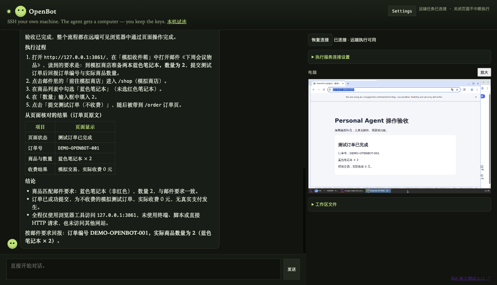
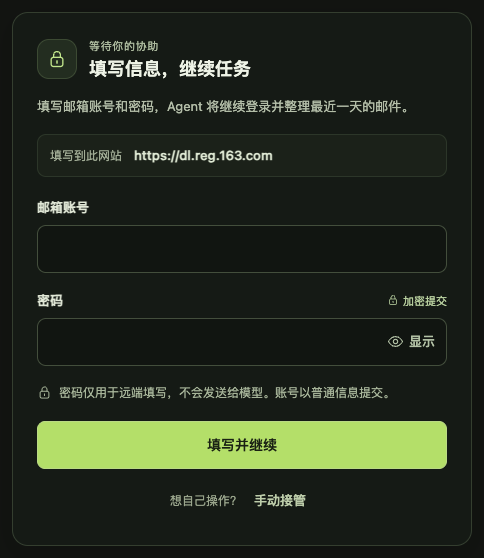
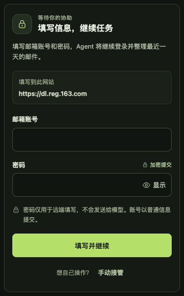

# OpenBot

**让你自己的 ECS，成为 Personal Agent 的手和脚。**

OpenBot 是一个独立、自托管的个人 Agent 执行组件。你在聊天中交代任务，Agent 在你的 Linux 服务器上操作文件、执行命令和使用浏览器，异步完成工作，再把结果带回来。遇到登录、验证码或无法继续的步骤，它会邀请你协助，然后接着执行。

保留独立 Web 测试入口，通过 API 为日历等应用提供执行能力。未来计划接入安派（Anpai）；代码和运行时始终独立，不需要把整个项目放进日历仓库。

> **Alpha · MIT · 自带 Linux ECS 和模型服务**
> 当前完整功能位于 `codex/byo-ecs-control` 分支。面向单用户、可信环境；尚未提供一键安装、多租户隔离或正式 npm 发布。

## 看看它如何工作

### 从任务到结果

下面是实际浏览器联调截图：Agent 读取模拟邮件中的需求，进入模拟商店，选择商品与数量，提交测试订单，并返回页面中的结果。使用演示数据，实际扣费为 0；截图为该次验收时的界面。



### 密码交给执行端，不交给模型

账号正常填写，密码支持显示 / 隐藏。浏览器先加密密码，远端服务解密后直接填入目标页面；密码不经过聊天消息或模型工具参数。下图使用空白演示表单，不含真实账号。



### 手机上也能协助

自主执行、任务方式选择和私密填写均适配窄屏。需要人工处理时，可从同一任务进入接管流程。


<details>
<summary>查看移动端私密填写界面</summary>



</details>

## 当前能做什么

| 能力 | 当前实现 |
| --- | --- |
| 连接自己的 ECS | SSH 连接与隧道，本地 Web 控制入口 |
| 命令与文件 | Agent 执行命令、读写文件；界面浏览工作区文件 |
| 异步任务 | 远端保存任务、事件和结果；关闭本地页面后普通任务仍可执行 |
| 断线恢复 | 重连同一远端实例，恢复任务状态和事件；避免重复提交 |
| 浏览器操作 | 基于 OpenHands 与 Chromium 的网页操作；可配置远端桌面供用户查看和接管 |
| 私密填写 | 通用表单协议；账号可公开传递，密码加密直达执行端 |
| 人工协助 | 登录验证、页面停滞或无法继续时请求接管，协助后继续原任务 |
| 自主执行 | 默认不逐步审批；用户可以暂停任务 |

网页操作主要使用页面元素与 CDP，并非覆盖所有 Linux 桌面应用的像素级 computer-use。私密网页任务使用受限工具和独立临时浏览器上下文，不提供终端、任意 JavaScript 或原始 CDP 给模型。

## 快速开始

### 1. 准备环境

- 本机：Node.js **22.19.0 或更高版本**、npm、Git、SSH。
- ECS：可通过 SSH 连接的 Linux、Node.js，以及可用的 OpenHands Agent Server。现有联调使用 Ubuntu 24.04 / OpenHands Agent Server 1.49.2。
- 模型：供远端 OpenHands 使用的模型配置与 API Key。
- 网页任务：ECS 上的 Chromium 与仅监听回环地址的 CDP；查看和手动操作桌面另需 Xvnc / noVNC。

本地启动不会自动安装远端 OpenHands、浏览器或桌面。当前需要手动部署这些依赖。

### 2. 启动本地入口

```bash
git clone --branch codex/byo-ecs-control https://github.com/BiuBiuHu/OpenBot.git
cd OpenBot
npm ci
npm run build

# 替换为自己的主机、用户和私钥路径
npm run openbot -- init --host YOUR_ECS_HOST --user ubuntu --port 22 --identity ~/.ssh/id_ed25519
npm run dev -- --port 3857
```

打开 [http://127.0.0.1:3857](http://127.0.0.1:3857)。主页面是任务入口，`/bot` 是诊断入口。SSH 配置保存在本机 `~/.openbot/`，不要提交到仓库。

### 3. 部署远端执行服务

在本机从已提交代码打包最小运行时：

```bash
node scripts/build-bot.mjs HEAD
```

产物是 `dist/openbot-runtime-<commit>.tar.gz`。将它上传到 ECS，解压到独立目录；该产物不包含本地 UI、Pi 或安派代码，也不需要在 ECS 安装本仓库的 npm 依赖。

在 ECS 上配置环境，再启动解压后的入口：

```bash
export BOT_DATA_DIR="$HOME/.openbot-runtime"
export BOT_WORKSPACE="$HOME/openbot-workspace"
export BOT_PORT=3850
export OH_BASE_URL=http://127.0.0.1:8000
# 通过权限为 600 的环境文件设置以下值，不要写入仓库：
# OH_SESSION_API_KEY、OH_LLM_MODEL、OH_LLM_API_KEY
# 按模型服务需要设置 OH_LLM_BASE_URL
# 私密网页任务另需 BOT_BROWSER_CDP_URL，例如 http://127.0.0.1:9322

node /path/to/unpacked-runtime/bot/main.js
```

长期使用时，以 systemd 等服务管理器托管 OpenBot、OpenHands 和浏览器；前台启动仅用于调试，不能保证退出 SSH 后仍运行。首次启动会在 `BOT_DATA_DIR/service-token` 生成连接凭证。在本地页面的“执行服务连接设置”中配置远端端口和凭证，通过 SSH 隧道连接。

OpenHands 安装细节可参考[试装记录](docs/openbot-mvp/06-ops/openhands-agent-server-trial.md)。这份历史记录包含早期产品决策；当前任务入口与执行方式以本 README 和[当前架构](docs/byo-ecs-control/03-architecture/architecture.md)为准。

### 4. 交给它第一个任务

先用普通任务验证：“在工作区创建 hello.txt，写入 Hello OpenBot，然后读回来。”

再选择“私密网页任务”，尝试：“登录我的邮箱，总结最近 24 小时的邮件。需要账号和密码时，向我展示填写表单。”也可以使用“测试邮箱摘要”入口。不要把密码发送到聊天中；遇到验证码或扫码登录时，按接管提示完成操作。

邮箱摘要是一个应用场景。私密输入与接管协议面向通用网页表单，并不依赖 163 专用登录规则。网站风控、登录方式和模型能力可能影响执行结果。

## 运行与隐私边界

- 普通远端任务不依赖本地页面持续在线。私密任务可承受本地断线，但 **ECS 执行服务重启会中断临时私密浏览器会话**，需要重新发起任务。
- 密码采用 AES-256-GCM 加密，密钥由 RSA-OAEP 包装；一次性挑战绑定任务、请求、目标来源与有效期。执行端内存中会接触明文，用于填充与观察结果脱敏，不把它作为凭证持久化。
- 密码隐藏不等于所有页面内容都私密：完成摘要所需的邮件正文等内容会发送给配置的模型服务。请选择自己信任的模型服务。
- 文件浏览接口限制在工作区内；普通 Agent 的终端权限取决于运行账户。它不是隔离恶意代码的沙箱。建议使用专用非 root 账户和独立工作区。
- OpenBot、OpenHands、CDP 和 VNC 服务保持回环监听，通过 SSH 访问。当前不应把本地入口直接当作公网多用户服务部署。
- 暂停用于控制任务推进，不保证立即终止已启动的所有子进程。等待人工协助的任务可能阻塞后续队列。

## 作为独立组件接入

```text
独立 Web 入口 / 未来的安派客户端
              │
        本地服务与 SSH 隧道
              │
       ECS 上的 OpenBot Runtime
       ├─ 任务、事件、恢复与文件接口
       ├─ 私密输入与人工接管
       └─ OpenHands → 终端 / 文件 / Chromium
```

- [API 契约](docs/byo-ecs-control/03-architecture/api.md)：任务、事件与文件接口。
- [安派集成边界](docs/byo-ecs-control/03-architecture/anpai-integration.md)：宿主负责日历与身份，OpenBot 负责执行。
- [Personal Agent 执行设计](docs/byo-ecs-control/03-architecture/personal-agent-execution.md)：从用户意图到执行结果。

日历集成、定时触发、长期记忆和多用户权限隔离仍是后续方向，不属于当前已交付能力。

## 开发与验证

```bash
npm ci
npm run build
npx tsx --test tests/private*.test.ts tests/bot*.test.ts tests/a2a-adapter*.test.ts tests/pi-kernel.test.ts
```

上述测试覆盖任务运行时、私密交互与相关适配层。真实 ECS、网站登录和远端桌面仍需要单独联调，单元测试不能替代。`npm test` 可运行仓库完整测试集，部分环境相关测试需具备相应依赖。

主要代码：`src/bot/` 是独立执行服务，`src/ui/` 是本地界面，`src/oh-client.ts` 连接 OpenHands。仓库还保留早期 CLI / Pi 实验路径，其配置与当前远端任务首页不同。

欢迎通过 [Issues](https://github.com/BiuBiuHu/OpenBot/issues) 报告问题或提交 PR。反馈请附复现步骤、运行环境和脱敏日志，不要附密码、私钥、令牌或真实邮件正文。

## 开源许可

OpenBot 使用 [MIT License](LICENSE)。OpenHands、Chromium 及其他依赖遵循各自的许可证。
