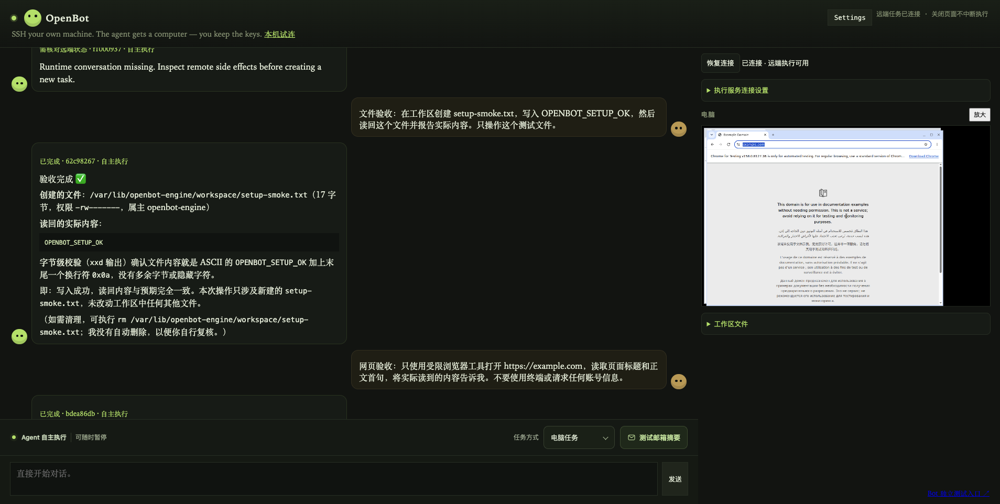

# OpenBot

**English** | [简体中文](README.zh-CN.md)

**Give your personal agent a computer of its own.**

Describe a task. Your agent uses a browser, works with files, and brings back results from your own Linux server. Watch the remote desktop or take over whenever you need to.


**A real integration test:** the agent read a simulated email, opened a demo store, selected two notebooks, submitted a test order, and reported the result. All data was synthetic; no real purchase or payment occurred. Screenshots show the current Chinese-language interface; English documentation does not imply a fully localized UI.

[Get started](#installation-and-setup) · [Features](#what-works-today) · [Integrate OpenBot](#integrating-openbot)

> **Alpha · MIT · Self-hosted**
>
> Bring your own Linux server and model API. Set up the execution engine, browser, and visible desktop together. Currently intended for a single user in a trusted environment.

## Help only when needed

Tasks run asynchronously on your server. When a login, verification challenge, or other obstacle requires your help, the agent asks for input or hands over control so you can help it continue.

| Private input, delivered to the executor | Assist from your phone |
| --- | --- |
|  |  |
| Account names are passed normally. Passwords are encrypted before submission and decrypted by the remote executor for entry into the website, without entering chat or model tool arguments. | Fill in requested information or enter the takeover flow from a mobile browser. |

*These are empty demonstration forms, with no real account credentials.*

<details>
<summary>More screenshots: mobile controls and a freshly initialized server</summary>

**Mobile task controls**


**File and browser tasks on a freshly initialized server**

This actual test run shows a file write/read task, a browser task, and the visible desktop. The historical notice at the top records an earlier failed task; the tasks below completed after the issue was fixed.



</details>

OpenBot has its own Web interface and exposes APIs for other applications. Integration with Anpai, a calendar application, is planned. The code and runtime remain independent of the calendar repository.

## What works today

| Capability | Current implementation |
| --- | --- |
| Your own server | SSH connections and tunnels, with a local Web interface |
| Commands and files | Agent command execution and file read/write operations; a workspace file browser |
| Asynchronous tasks | Tasks, events, and results persisted remotely; ordinary tasks continue after you close the local page |
| Reconnection | Reconnect to the same remote instance and recover task state and events without duplicate submissions |
| Browser automation | OpenHands and Chromium, with a visible remote desktop for observation and takeover |
| Private input | A reusable form protocol; account names can be passed normally, while passwords are encrypted for the executor |
| Human assistance | Request takeover for login challenges or blocked steps, then continue the task |
| Autonomous execution | No approval for each step by default; users can pause tasks |

Browser automation primarily uses page elements and CDP. It is not general pixel-based computer use across all Linux desktop applications. Private browser tasks use restricted tools and isolated temporary browser contexts; the model does not receive terminal access, arbitrary JavaScript execution, or raw CDP access in this mode.

## Installation and setup

Full server initialization is available on `main`. “ECS” in the interface refers to your cloud server or Linux virtual machine.

### 1. Prepare a server

| Requirement | Details |
| --- | --- |
| Local machine | Node.js ≥ 22.19.0, npm, Git, and SSH; the local interface has been verified on macOS |
| Server | Ubuntu 24.04, x86_64, systemd; automatic setup does not yet support other systems |
| Access | SSH private-key authentication as root or an account with passwordless sudo |
| Resources | Recommended: at least 2 CPU cores, 4 GiB RAM, and 4 GiB free disk space for dependencies and download caches, plus space for your files |
| Network | Your machine must reach the server over SSH; the server must reach system package repositories, download sources, and the model API |
| Model | A model name, API key, and optional API base URL; an existing local OpenAI-compatible configuration can be reused |

**You do not need to install OpenHands, Chromium, a desktop, or Bot Runtime manually.** Setup prepares Python, Node, native libraries, fonts, terminal utilities, and the services. SSH and the system package manager are prerequisites for bootstrapping the remote installation.

### 2. Start OpenBot locally

```bash
git clone https://github.com/BiuBiuHu/OpenBot.git
cd OpenBot
npm ci
npm run build
npm run dev -- --port 3857
```

Open [http://127.0.0.1:3857](http://127.0.0.1:3857) and go to **Settings**. Some controls currently have Chinese labels; the exact labels are included below to help you find them.

1. Enter **Host**, **User**, **SSH Port**, and your local private-key file path, then click **Save and connect**. The private key stays on your machine; do not paste its contents.
2. Under **Initialize remote computer** (`初始化远端电脑`), enter the model name, API base URL, and API key. Leave the key blank to reuse a saved key. An unreachable-service notice after first saving SSH settings is expected before initialization.
3. Click **Initialize / check remote computer** (`初始化 / 检查远端电脑`). Initial downloads can take several minutes. The page shows progress and disables the button while setup runs.
4. Wait for the environment-ready message (`电脑环境已就绪`). Internal credentials are saved automatically, and the page connects to the task service and visible desktop. You do not need to copy OpenHands or Bot tokens.

Model names use the OpenHands / LiteLLM format, such as `deepseek/deepseek-chat`. When reusing a local OpenAI-compatible configuration, setup adds the `openai/` routing prefix and keeps its base URL. API keys travel over SSH into restricted configuration files, not through chat or installation command arguments.

The **CLI** uses the same installer:

```bash
# Replace the host, user, and key path with your own values.
npm run openbot -- init --host YOUR_ECS_HOST --user ubuntu --port 22 --identity ~/.ssh/id_ed25519

# First configure OH_LLM_MODEL and OH_LLM_API_KEY in ~/.openbot/.env.
# Set OH_LLM_BASE_URL if needed, or reuse an existing local model configuration.
# Never put real keys in command arguments, chat, or the repository.
npm run openbot -- setup
npm run dev -- --port 3857
```

### 3. What setup installs

| Component | Version management | Purpose |
| --- | --- | --- |
| OpenHands Agent Server / SDK / Tools / Workspace | Pinned to 1.49.2, with version- and SHA-256-locked transitive dependencies | Model loop, terminal, file, and browser tools |
| Node.js | Pinned to 22.23.5, with download hash verification | Runs the standalone Bot Runtime |
| Chromium (Chrome for Testing) | Pinned to 158.0.8127.36, with download hash verification | A visible browser shared by the agent and user |
| TigerVNC, Openbox, noVNC, websockify, fonts, and native libraries | Managed by Ubuntu package repositories | Remote desktop, window management, and Web viewing |
| Bot Runtime | Automatically packaged from the current committed Git revision and verified | Persistent tasks, events, file APIs, private input, and recovery |

The OpenHands 1.49.2 installation includes a narrowly scoped compatibility patch: missing optional cache-usage metadata is treated as zero rather than failing a task. Patch validation and provenance are documented in the [verification record](docs/managed-openhands/04-engineering/evidence-manifest.md) (Chinese).

OpenHands downloads use a public PyPI mirror first, with fallback to the official index. Binary downloads also require matching hashes; changing the download source does not relax version or integrity checks. Application versions change through explicit project updates, while system dependencies use distribution-maintained packages.

Services run as the dedicated non-root user `openbot-engine`, managed by systemd and enabled at boot. Installation files live in `/opt/openbot-engine`; persistent data lives in `/var/lib/openbot-engine`. Other existing OpenHands, desktop, and Bot services are not overwritten.

Internal ports listen only on the server's loopback interface and are accessed over SSH tunnels. **Do not open these ports to the public internet.**

| Service | Remote port |
| --- | --- |
| OpenHands | 18000 |
| Bot Runtime | 13850 |
| Chromium CDP | 19322 |
| VNC / Web desktop | 15901 / 16080 |

Before reporting success, setup checks non-root file creation, reading, and cleanup; input and clicks in the visible browser; the task service identity endpoint; and the Web desktop endpoint. Repeated setup preserves credentials, tasks, and browser profiles. Healthy services are not restarted when versions and configuration are unchanged. Unfinished tasks block initialization; finish or cancel them first, and initialize while the server is idle.

### 4. Try your first task

Ask: “Create hello.txt in the workspace, write Hello OpenBot, and read it back.” You should receive a completion result and find the file under **Workspace files** (`工作区文件`).

Next, submit a simple browser task and watch the browser on the right. Refreshing the local page should restore the same task and result without running it twice.

For email, choose **Private browser task** (`私密网页任务`) and ask: “Log in to my mailbox and summarize emails from the past 24 hours. Show me an input form when you need my account and password.” Do not send passwords in chat. Take over for verification codes or QR login, then continue the task. Website restrictions and model capabilities can still affect the outcome.

### 5. Troubleshooting

| Symptom | What to check |
| --- | --- |
| SSH fails or the key is missing | Verify the host, user, port, and local key path; confirm that SSH login works from your machine |
| Insufficient sudo permissions | Use an account with the required permissions, then retry |
| Unsupported system | Use Ubuntu 24.04 x86_64; setup does not assume other distributions are compatible |
| Download failure or insufficient disk space | Check outbound connectivity, package repositories, and disk space, then retry setup |
| Port already in use | Inspect the conflicting service; setup does not stop unrelated services |
| Unfinished tasks | Complete or cancel them before initialization to avoid losing temporary browser sessions |
| Page disconnected | Restore the local service and reconnect; do not delete data or reset credentials to resolve an uncertain installation state |
| Services start but tasks report model errors | Check the model name, API URL, key, and quota; setup probes do not call the model, so actual tasks are needed to verify the provider |

Inspect services on the server:

```bash
sudo systemctl status openbot-engine openbot-desktop openbot-browser openbot-viewer openbot-runtime --no-pager
sudo journalctl -u openbot-runtime -u openbot-browser -n 80 --no-pager
sudo tail -n 80 /opt/openbot-engine/install.log
```

Redact logs and environment files before sharing them in an issue. Installation failures preserve the previous connection configuration; failed service activation attempts to restore previous units and configuration. Do not delete `/var/lib/openbot-engine` to troubleshoot connectivity: it contains tasks and browser data.

For manual deployment, standalone Runtime packaging, and interface details, see the [architecture](docs/byo-ecs-control/03-architecture/architecture.md) and [installation verification record](docs/managed-openhands/04-engineering/evidence-manifest.md). These engineering documents are currently in Chinese.

## Runtime and privacy boundaries

- Ordinary remote tasks do not require the local page to stay open. Private tasks tolerate local disconnections, but **restarting the remote execution service interrupts temporary private browser sessions**, requiring a new task.
- Passwords use AES-256-GCM encryption with RSA-OAEP key wrapping. One-time challenges bind input to the task, request, target origin, and expiry. The executor handles plaintext in memory for filling and observation redaction, without persisting it as a credential.
- Password protection does not make all page content private from the model. Content needed to complete a task, such as email bodies for a summary, is sent to your configured model provider. Choose a provider you trust.
- File browsing is restricted to the workspace. Ordinary agent terminal access has the permissions of its operating-system account; it is not a sandbox for malicious code. Use a dedicated non-root account and workspace.
- Keep OpenBot, OpenHands, CDP, and VNC on loopback interfaces and access them through SSH. The local interface is not intended as a public multi-user service.
- Pausing controls task progression but does not guarantee immediate termination of all child processes. Tasks awaiting human assistance may block subsequent queued work.

## Integrating OpenBot

```text
Standalone Web UI / future Anpai client
                  |
       Local service and SSH tunnels
                  |
       OpenBot Runtime on your server
       ├─ Tasks, events, recovery, and file APIs
       ├─ Private input and human takeover
       └─ OpenHands → terminal / files / Chromium
```

Engineering references (currently in Chinese):

- [API contract](docs/byo-ecs-control/03-architecture/api.md): tasks, events, and files.
- [Anpai integration boundary](docs/byo-ecs-control/03-architecture/anpai-integration.md): the host owns calendar features and identity; OpenBot owns execution.
- [Personal agent execution design](docs/byo-ecs-control/03-architecture/personal-agent-execution.md): from user intent to execution results.

Calendar integration, scheduled triggers, long-term memory, and multi-user permission isolation are future directions, not currently delivered features.

## Development and verification

```bash
npm ci
npm run build
npx tsx --test tests/private*.test.ts tests/bot*.test.ts tests/a2a-adapter*.test.ts tests/pi-kernel.test.ts tests/managed-openhands.test.ts
python3 tests/managed_installer_test.py
```

These tests cover the task runtime, private interactions, and related adapters. Real servers, website logins, and remote desktops require separate integration testing. Run `npm test` for the full suite; some environment-dependent tests require additional prerequisites.

Key code: `src/bot/` contains the standalone execution service, `src/ui/` the local interface, and `src/oh-client.ts` the OpenHands client. The repository also retains earlier CLI / Pi experiments with configuration separate from the current remote-task homepage.

Contributions and [issues](https://github.com/BiuBiuHu/OpenBot/issues) are welcome. Include reproduction steps, environment details, and redacted logs. Do not include passwords, private keys, tokens, or real email content.

When changing setup instructions, capabilities, or limitations, update both `README.md` and `README.zh-CN.md`. Keep screenshots authentic and distinguish tested behavior from planned features.

## License

OpenBot is licensed under the [MIT License](LICENSE). OpenHands, Chromium, and other dependencies retain their respective licenses.
