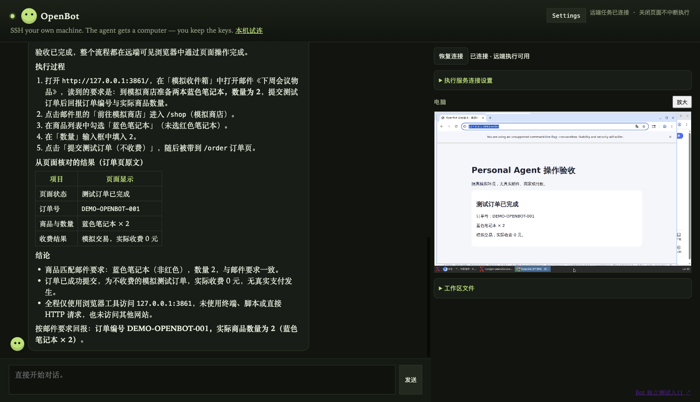
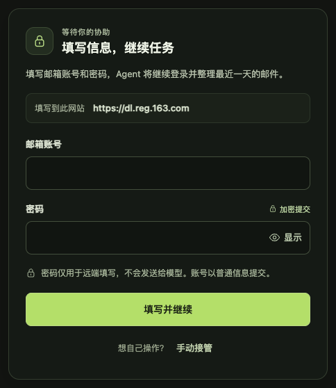
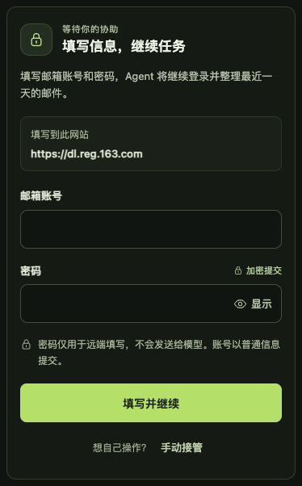
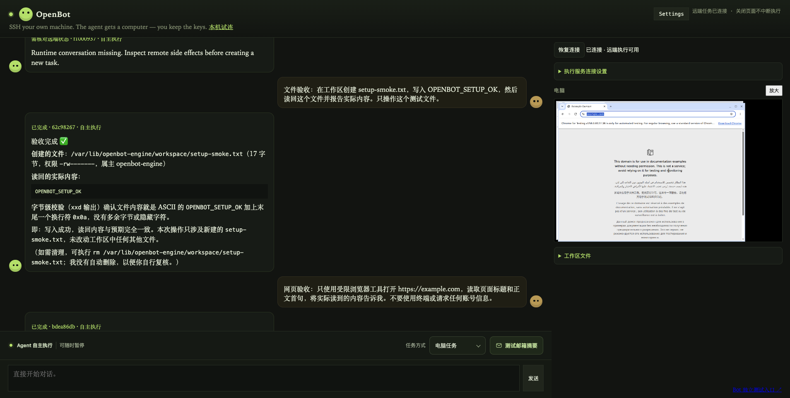
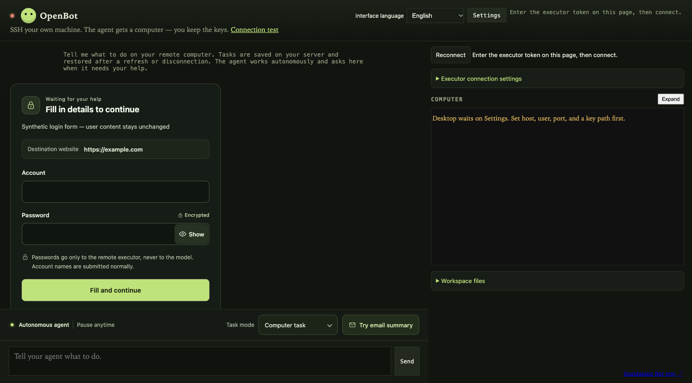

# OpenBot

[English](README.md) | **简体中文**

**让你自己的 ECS，成为 Personal Agent 的手和脚。**

用一句话交代任务，让 Agent 在你自己的 Linux ECS 上操作浏览器、读写文件并带回结果。你可以看到远端电脑，也可以随时接管。



**上图是实际联调画面：** Agent 读取模拟邮件 → 打开模拟商店 → 选择两本笔记本 → 提交测试订单 → 返回订单结果。全程使用演示数据，没有真实购买或扣费。

[开始安装](#安装与初始化) · [了解能力](#当前能做什么) · [接入自己的应用](#作为独立组件接入)

> **Alpha · MIT · 自托管**
>
> 自带 Linux ECS 和模型服务；一键准备执行引擎、浏览器和可视桌面。当前面向单用户、可信环境。

## 需要你时，再请你帮忙

任务在远端异步执行。遇到登录、验证码或无法继续的步骤，Agent 会请求协助；你可以填写信息或接管电脑，然后继续任务。

| 私密填写：密码直达执行端 | 手机端：也能协助任务 |
| --- | --- |
|  |  |
| 账号正常传递；密码先加密，再由远端解密填入网页，不进入聊天或模型工具参数。 | 无需回到电脑前，在手机上填写信息或进入接管流程。 |

*以上为空白演示表单，不含真实账号或密码。*

<details>
<summary>查看更多：手机端任务入口与完整环境实测</summary>

**手机端任务入口**


**新初始化的 ECS：文件读写与网页任务**

下面是独立测试环境的真实记录，包含文件写入读回、网页读取和可视桌面。画面上方保留了首次失败任务的历史提示；修复后下方任务已完成。



</details>

OpenBot 保留独立 Web 入口，也通过 API 为其他应用提供执行能力。未来计划接入安派（Anpai）；代码与运行时始终独立，不需要放进日历仓库。

<details>
<summary>英文界面预览</summary>



该界面测试使用空白演示表单，未连接真实服务器，用于展示语言支持，不代表远端任务完成。

</details>

## 当前能做什么

| 能力 | 当前实现 |
| --- | --- |
| 连接自己的 ECS | SSH 连接与隧道，本地 Web 控制入口 |
| 命令与文件 | Agent 执行命令、读写文件；界面浏览工作区文件 |
| 异步任务 | 远端保存任务、事件和结果；关闭本地页面后普通任务仍可执行 |
| 断线恢复 | 重连同一远端实例，恢复任务状态和事件；避免重复提交 |
| 浏览器操作 | 基于 OpenHands 与 Chromium 的网页操作；可配置远端桌面供用户查看和接管 |
| 私密填写 | 通用表单协议；账号可公开传递，密码加密直达执行端 |
| 人工协助 | 登录验证、页面停滞或无法继续时请求接管，协助后继续原任务 |
| 自主执行 | 默认不逐步审批；用户可以暂停任务 |

网页操作主要使用页面元素与 CDP，并非覆盖所有 Linux 桌面应用的像素级 computer-use。私密网页任务使用受限工具和独立临时浏览器上下文，不提供终端、任意 JavaScript 或原始 CDP 给模型。

## 安装与初始化

完整 ECS 初始化已合并到 `main`，按下面的步骤即可开始。

### 1. 准备一台 ECS

| 项目 | 要求 |
| --- | --- |
| 本机 | Node.js ≥ 22.19.0、npm、Git、SSH；本地入口已在 macOS 验证 |
| ECS | Ubuntu 24.04、x86_64、systemd；其他系统暂不支持自动初始化 |
| 权限 | 能用 SSH 私钥登录；连接账户为 root 或具有免密 sudo 权限 |
| 资源 | 建议至少 2 核 / 4 GiB 内存，预留 4 GiB 以上磁盘供依赖和下载缓存使用；用户文件另计 |
| 网络 | 本机能 SSH 到 ECS；ECS 能访问系统软件源、安装包下载源与模型 API |
| 模型 | 模型名称、API Key，以及需要时填写的服务地址；可以复用已保存的本机 OpenAI-compatible 配置 |

**无需预先手动安装 OpenHands、Chromium、桌面或 Bot Runtime。** 初始化器会准备 Python、Node、原生运行库、字体、终端工具与这些服务。SSH 和系统包管理器是远端启动安装所需的基础条件。

### 2. 在本机启动 OpenBot

```bash
git clone https://github.com/BiuBiuHu/OpenBot.git
cd OpenBot
npm ci
npm run build
npm run dev -- --port 3857
```

打开 [http://127.0.0.1:3857](http://127.0.0.1:3857)，进入 **设置（Settings）**。界面首次跟随浏览器语言：中文系列使用简体中文，其余语言使用英文。顶部“界面语言”可选择简体中文、English 或跟随浏览器；手动选择会在当前浏览器中记住，并同步到本地其他标签页，切换不会刷新页面或清空输入。这与本机聊天回复语言独立，任务结果和远端网站保留原文。

1. 填写 Host、User、SSH Port 和本机私钥文件路径，点击 **Save and connect**。私钥留在本机，不要粘贴私钥内容。
2. 在“初始化远端电脑”中填写模型名称、模型服务地址和 API Key。已保存 Key 时留空可继续使用；初次保存 SSH 后提示远端服务不可达是正常的，继续初始化即可。
3. 点击 **初始化 / 检查远端电脑**。首次下载可能需要数分钟，页面会显示进行状态，避免重复点击。
4. 等待“电脑环境已就绪”。内部凭据会自动保存，页面自动连接任务服务和可视桌面，无需复制 OpenHands 或 Bot 的令牌。

模型名称采用 OpenHands / LiteLLM 格式，例如 `deepseek/deepseek-chat`。复用本机 OpenAI-compatible 服务时，安装器会添加 `openai/` 路由前缀并沿用原服务地址。API Key 不进入聊天或安装命令参数，经 SSH 传到 ECS 的受限配置文件。

**命令行方式**与页面使用同一安装器：

```bash
# 替换为自己的主机、用户和私钥路径
npm run openbot -- init --host YOUR_ECS_HOST --user ubuntu --port 22 --identity ~/.ssh/id_ed25519

# 先在本机 ~/.openbot/.env 中配置 OH_LLM_MODEL、OH_LLM_API_KEY，
# 按需配置 OH_LLM_BASE_URL；也可复用已保存的本机模型配置。
# 不要将真实 Key 放进命令参数、聊天或仓库。
npm run openbot -- setup
npm run dev -- --port 3857
```

### 3. 初始化会安装什么

| 组件 | 管理方式 | 用途 |
| --- | --- | --- |
| OpenHands Agent Server / SDK / Tools / Workspace | 固定 1.49.2，传递依赖版本与 SHA-256 锁定 | 模型循环、终端、文件与浏览器工具 |
| Node.js | 固定 22.23.5，校验下载哈希 | 运行独立 Bot Runtime |
| Chromium（Chrome for Testing） | 固定 158.0.8127.36，校验下载哈希 | 同时供 Agent 和用户操作的可视浏览器 |
| TigerVNC、Openbox、noVNC、websockify、字体及原生库 | Ubuntu 软件仓库管理 | 远端桌面、窗口管理与网页查看 |
| Bot Runtime | 从当前已提交的 Git 版本自动打包并校验 | 持久化任务、事件、文件接口、私密填写与恢复 |

OpenHands 1.49.2 包含一处受版本检查约束的兼容补丁：模型服务未返回可选的缓存用量字段时按 0 处理，避免任务报错；补丁校验与来源见[验证记录](docs/managed-openhands/04-engineering/evidence-manifest.md)。

OpenHands 优先使用公开 PyPI 镜像，失败后回退官方源；二进制下载也执行固定哈希校验，不会因更换下载源而放宽版本。应用版本由项目明确更新，不随安装自动追踪最新版；系统依赖继续采用发行版维护的软件包。

服务以专用非 root 账户 `openbot-engine` 运行，由 systemd 管理并开机自启。安装内容位于 `/opt/openbot-engine`，持久数据位于 `/var/lib/openbot-engine`。既有其他 OpenHands / 桌面 / Bot 服务不会被覆盖。

内部端口只监听 ECS 回环地址，通过 SSH 隧道访问，**无需开放这些公网端口**：

| 服务 | 远端端口 |
| --- | --- |
| OpenHands | 18000 |
| Bot Runtime | 13850 |
| Chromium CDP | 19322 |
| VNC / 网页桌面 | 15901 / 16080 |

安装完成前会验证：非 root 文件写入、读取与清理；同一可视浏览器中的输入和点击；任务服务身份接口；网页桌面入口。重复初始化保留凭据、任务数据和浏览器资料；配置与版本未变时不重启正常服务。检测到未结束任务会拒绝重启，请先完成或取消任务，并在空闲时初始化。

### 4. 验证第一个任务

在主页提交：“在工作区创建 hello.txt，写入 Hello OpenBot，然后读回来。”应看到任务完成结果，也能在“工作区文件”中找到文件。

再提交一个简单网页任务，观察右侧桌面的浏览器是否执行操作。刷新本地页面后，应恢复同一任务及其结果，不应重复执行。

邮箱场景可选择“私密网页任务”，输入：“登录我的邮箱，总结最近 24 小时的邮件。需要账号和密码时，向我展示填写表单。”不要把密码发到聊天里；验证码或扫码等步骤由用户接管，完成后继续原任务。网站风控和模型能力仍可能影响执行结果。

### 5. 安装失败怎么处理

| 提示或现象 | 处理方式 |
| --- | --- |
| SSH 不通 / 私钥找不到 | 检查主机、用户名、端口与本机私钥路径；先确认本机可以正常 SSH 登录 |
| sudo 权限不足 | 为安装账户配置所需权限，或使用有权限的连接账户，再重试 |
| 系统不支持 | 使用 Ubuntu 24.04 x86_64；安装器不会将其他发行版当成兼容环境继续安装 |
| 下载失败 / 空间不足 | 检查 ECS 出站网络、软件源和磁盘空间，修复后重新点击初始化 |
| 端口被占用 | 检查冲突服务；安装器不会擅自关闭已有服务 |
| 有未结束任务 | 完成或取消任务后再初始化，避免丢失临时浏览器会话 |
| 页面断线 | 恢复本地服务后重新检查；安装结果不明确时不要删除数据目录或重置凭据 |
| 服务已启动但任务报模型错误 | 检查模型名称、API 地址、Key 和额度；初始化自测不消耗模型调用，实际任务才验证模型服务 |

在 ECS 上查看运行情况：

```bash
sudo systemctl status openbot-engine openbot-desktop openbot-browser openbot-viewer openbot-runtime --no-pager
sudo journalctl -u openbot-runtime -u openbot-browser -n 80 --no-pager
sudo tail -n 80 /opt/openbot-engine/install.log
```

日志与环境文件可能包含运行信息，请脱敏后再提交 Issue。安装失败保留原连接配置；新服务切换失败会尝试恢复旧单元和配置。不要通过删除 `/var/lib/openbot-engine` 解决连接问题，该目录包含任务和浏览器资料。

开发者手动部署、独立 Runtime 打包及接口说明见[当前架构](docs/byo-ecs-control/03-architecture/architecture.md)和[安装验证记录](docs/managed-openhands/04-engineering/evidence-manifest.md)。

## 运行与隐私边界

- 普通远端任务不依赖本地页面持续在线。私密任务可承受本地断线，但 **ECS 执行服务重启会中断临时私密浏览器会话**，需要重新发起任务。
- 密码采用 AES-256-GCM 加密，密钥由 RSA-OAEP 包装；一次性挑战绑定任务、请求、目标来源与有效期。执行端内存中会接触明文，用于填充与观察结果脱敏，不把它作为凭证持久化。
- 密码隐藏不等于所有页面内容都私密：完成摘要所需的邮件正文等内容会发送给配置的模型服务。请选择自己信任的模型服务。
- 文件浏览接口限制在工作区内；普通 Agent 的终端权限取决于运行账户。它不是隔离恶意代码的沙箱。建议使用专用非 root 账户和独立工作区。
- OpenBot、OpenHands、CDP 和 VNC 服务保持回环监听，通过 SSH 访问。当前不应把本地入口直接当作公网多用户服务部署。
- 暂停用于控制任务推进，不保证立即终止已启动的所有子进程。等待人工协助的任务可能阻塞后续队列。

## 作为独立组件接入

```text
独立 Web 入口 / 未来的安派客户端
              │
        本地服务与 SSH 隧道
              │
       ECS 上的 OpenBot Runtime
       ├─ 任务、事件、恢复与文件接口
       ├─ 私密输入与人工接管
       └─ OpenHands → 终端 / 文件 / Chromium
```

- [API 契约](docs/byo-ecs-control/03-architecture/api.md)：任务、事件与文件接口。
- [安派集成边界](docs/byo-ecs-control/03-architecture/anpai-integration.md)：宿主负责日历与身份，OpenBot 负责执行。
- [Personal Agent 执行设计](docs/byo-ecs-control/03-architecture/personal-agent-execution.md)：从用户意图到执行结果。

日历集成、定时触发、长期记忆和多用户权限隔离仍是后续方向，不属于当前已交付能力。

## 开发与验证

```bash
npm ci
npm run build
npx tsx --test tests/private*.test.ts tests/bot*.test.ts tests/a2a-adapter*.test.ts tests/pi-kernel.test.ts tests/managed-openhands.test.ts
python3 tests/managed_installer_test.py
```

上述测试覆盖任务运行时、私密交互与相关适配层。真实 ECS、网站登录和远端桌面仍需要单独联调，单元测试不能替代。`npm test` 可运行仓库完整测试集，部分环境相关测试需具备相应依赖。

主要代码：`src/bot/` 是独立执行服务，`src/ui/` 是本地界面，`src/oh-client.ts` 连接 OpenHands。仓库还保留早期 CLI / Pi 实验路径，其配置与当前远端任务首页不同。

欢迎通过 [Issues](https://github.com/BiuBiuHu/OpenBot/issues) 报告问题或提交 PR。反馈请附复现步骤、运行环境和脱敏日志，不要附密码、私钥、令牌或真实邮件正文。

修改安装指引、能力或限制时，请同步更新 `README.md` 与 `README.zh-CN.md`。截图应来自真实界面，并区分已验证能力与未来计划。

## 开源许可

OpenBot 使用 [MIT License](LICENSE)。OpenHands、Chromium 及其他依赖遵循各自的许可证。
