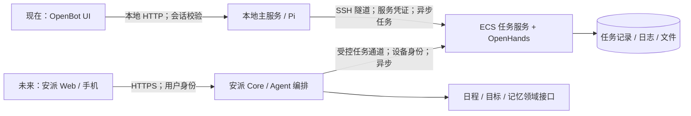

# Personal Agent 与安派接入决策

## 0. 版本历史

| 版本 | 日期 | 变更 | 原因 | 影响 |
|---|---|---|---|---|
| v0.1 | 2026-11-20 | 保留独立测试入口，设计未来安派集成边界 | 用户明确现在独立测试、未来集成日历 | 当前继续 ECS 链路，不提前合并产品 UI |

## 1. 当前决策

OpenBot 现有 UI 是 Personal Agent 的独立测试入口。现在跑通连接 ECS、聊天执行、工作区文件和长期任务恢复；未来安派作为另一个客户端接入同一能力。无需现在迁移安派或重做日历。

本次读取安派本地架构材料：`dida-core/docs/memory-v2/03-architecture/architecture.md`、`life-assistant-schedule-query/03-architecture/architecture.md`、`review-center-langgraph/03-architecture/architecture.md`，并发现已连接插件暴露日程查询、搜索、找空档及创建工具。仅证明这些设计/接口存在，不证明所有能力线上验收完成；没有查询用户实际日程或写入日历。

## 2. 产品关系

- Personal Agent：理解委托，必要时读取个人上下文，创建可追踪任务，执行后返回证据，遇到需要用户决定的操作暂停。
- 安派：拥有用户身份、日程、目标及个人记忆的权威数据，未来展示 Agent 的任务与结果。
- ECS：执行环境，拥有执行过程、日志与原始产物。无 ECS 的日历查询不应被强制发到 ECS。
- OpenBot UI：当前完整测试工具，未来可保留为开发诊断入口，不另建一份长期个人记忆或日历数据库。

## 3. 接入结构

两入口复用任务服务和数据契约，不要求复用整个本地聊天服务。未来个人上下文与规划优先复用安派已有 Agent 能力，避免两个主代理各维护一份记忆。安派 Core 的具体部署方式需再核验，不能假定请求型服务可以常驻 SSH 隧道或模型循环。

现在 SSH 隧道可用；未来手机接入应由 ECS 主动连接受控网关，或使用已鉴权的私网通道。手机不保存 SSH 私钥、不直连 ECS 管理端口；该网络迁移不是当前实施内容。

## 4. 当前需要稳定的契约

- Task：taskId、threadId、requestId、status、timestamps、result、artifacts。
- 来源：source.kind（openbot/anpai）、source.referenceId（未来日程/目标 ID），当前可为空。
- 调度预留：notBefore、deadline、timezone 属于后续能力，不因字段存在就宣称支持定时执行。
- 权限：当前单用户；为服务端派生的 owner 身份保留边界，未来不可信任客户端传入 userId。
- API：提交、查状态、事件续传、审批、取消、读取产物。任务完成与 UI 连接状态分离。
- 幂等：requestId 重试不重复启动任务；结果通知和日程写回同样独立防重。
- 数据归属：ECS 任务为执行状态权威；安派日程为时间安排权威。任务完成不能自动把用户的会议标成已完成。

## 5. 实施顺序与验收

1. 当前独立入口：提交“读取资料，生成 notes.md”；确认已接收后退出本地主服务；远端完成；重新打开看到同一任务并读回文件。还需验证拒绝审批、不重复执行及错误主机不可误用。
2. 稳定 API：同一调用不依赖网页组件、聊天渲染或笔记本内存；用第二个测试客户端验证查询和恢复。
3. 安派最小接入：用户在一个日程上点击“帮我准备”，明确授权读取相关资料；产生关联任务，结果卡回到该日程，可在另一端查看。先按需触发，不先做全自动扫描日历。
4. 有使用证据后再加会前准备、到期触发和周期任务。日程改期/删除必须更新或取消相应触发，避免旧计划继续执行；发消息、发布、付款等对外动作另有执行授权。

## 6. 未解决问题

安派 Core/AI service 的实际编排归属、记忆模块当前部署状态、跨端产物访问与长期运行通道需在集成阶段核验。当前不因此阻止独立入口实现。原工作区改动已恢复，保留 stash 保存点；本次未修改业务代码或部署服务。
