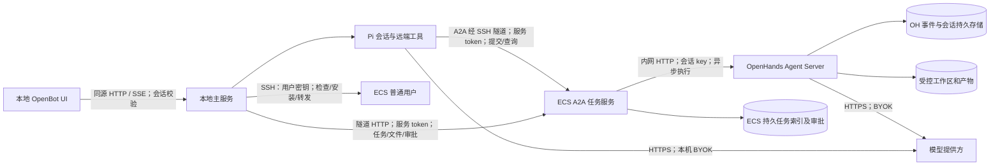
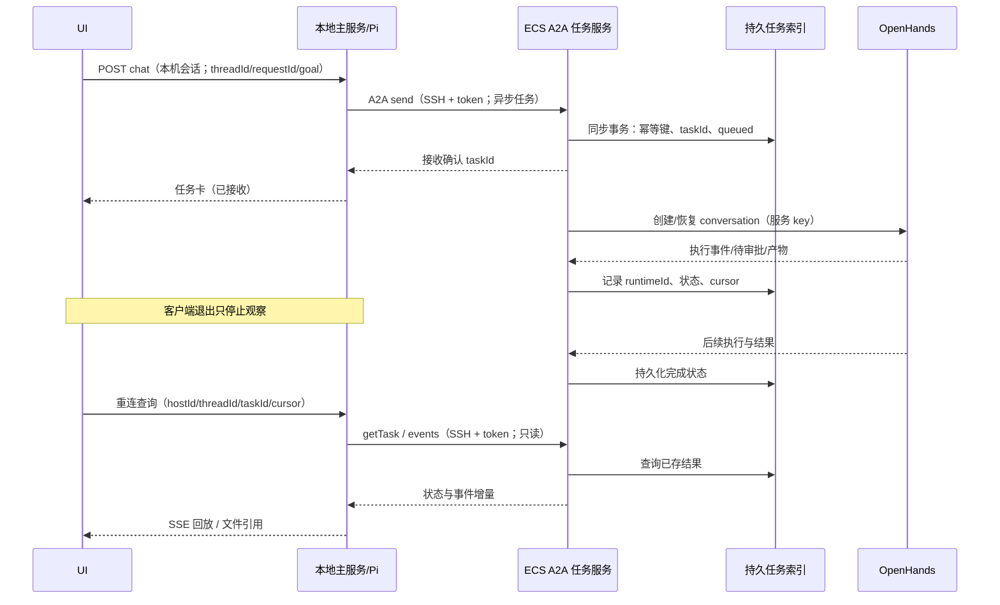

# 用户自带 ECS：建议架构

## 0. 版本历史

| 版本 | 日期 | 变更 | 原因 | 影响 |
|---|---|---|---|---|
| v0.1 | 2026-11-20 | 补持久化任务控制面设计 | 现有内存转发不满足离线恢复 | 保留 Pi/OH，新增能力标为拟实现 |

## 1. 当前决策

**实施更新（2026-11-20，替代下文初始提案中的 A2A/SQLite 选型）：**首版以独立 `src/bot/` REST v1 服务实现持久任务，使用单进程排他和原子 JSON 文件；既有 A2A/Pi 不迁移、不替换。UI `/bot` 经本地主服务调用 ECS，任务目标直接交给远端 OH；不依赖本机模型循环。契约见 [api.md](api.md)，安派代码和依赖保持独立。下文分层与状态原则保留，但 A2A 任务服务、SQLite、SSE、下载和进程级取消为原提案，未作为已交付能力。

沿用既定 runtime 决策：Pi 是本地聊天主代理，OpenHands 是 ECS 上的执行代理。将现有 A2A adapter 产品化为 ECS 常驻的薄任务服务，负责接收、状态映射、持久索引和审批转发，不再造模型循环。

本文件是设计，不是已交付能力。首版单用户/单机/单工作区，systemd 常驻，SSH 是接入及传输层。无桌面要求，无云厂商 SDK、独立认证平台、对象存储或移动端。本次不替代旧 feature 已有实现记录。

## 2. 分层架构

UI 只访问本地主服务。ECS 服务只监听 loopback，不把服务 token、内部 URL、模型 key 暴露给页面。SSH 私钥留在本机，模型凭证必须允许远端 Agent 独立访问其提供方。

## 3. 产品到技术映射

| 需求 | 模块 | 数据落点 | 验证 |
|---|---|---|---|
| 001 | connect/ssh/bootstrap + runtime identity | 本机配置、ECS identity | 空白主机安装与错主机拒绝 |
| 002/003 | Pi tools → A2A adapter → OH | ECS workspace、执行事件 | 实际文件及退出码 |
| 004/006 | TaskStore、异步 adapter、UI 观察恢复 | ECS 数据库、本机索引缓存 | 退出本机再恢复，无重复副作用 |
| 005 | 远端 policy/approval adapter | ECS approval 与工具调用关联 | 等待、拒绝、重连、一次性批准 |
| 007 | 主服务产物代理 | ECS 文件及元数据 | 大小、摘要和路径验证 |

## 4. 调用关系

审批链路：OH 必须在执行前暂停 → adapter 记录 approvalId、taskId、actionDigest → UI 展示具体动作 → 主服务转发允许/拒绝 → adapter 原子消费授权并调用已核验的 OH 审批接口。若当前 OH 版本不能安全支持该链路，相关能力保持不可用；不靠外层提示词或 NeverConfirm 代替执行门禁。

提交与 OH 创建间发生崩溃时，使用稳定 runtime conversation ID（需验证 API 幂等语义）或查询对账；不能确认执行归属时标记待核对，不自动重复启动。日志保留 taskId/requestId/eventSeq，不记录密钥。

## 5. 数据模型

拟选 ECS 本地 SQLite 保存控制元数据，采用成熟驱动；实施前依据锁定 Node 版本核验驱动可用性。模型会话仍使用 OH 的官方持久化，不复制第二份执行引擎。多用户和多节点不在本版范围。

- Host：hostId、SSH fingerprint、runtime identity/version、capabilities；endpoint 归属验证后才可使用。
- Task：taskId、hostId、threadId、requestId、goal、runtimeConversationId、status、timestamps、lastEventSeq、budget；(hostId, requestId) 唯一。
- Approval：approvalId、taskId、toolCallId、actionDigest、decision、consumedAt；一次性消费，执行参数变化需重审。
- Artifact：artifactId、taskId、relativePath、size、digest、version；不接受任意绝对路径作为下载入口。
- 本机线程：持久化聊天和远端任务引用；Pi 上下文恢复方案需按其 SDK 核验，禁止以全局 history 混用多线程。

## 6. API 契约

以下为拟新增产品契约，不表示现有路由可用：

- UI → 本地主服务：主机预检/安装进度、任务列表与详情、事件 cursor、审批提交、取消、文件列表/预览/下载。
- 主服务 → ECS：A2A send/get/cancel 等使用锁定 SDK 定义，支持快速返回持久 taskId；文件/安装等扩展走受控内部 API。
- agent card 必须与部署能力相符，只公布已验证能力；发现、任务、审批、文件均校验 token。外部卡里的 endpoint 必须符合选中主机隧道映射，禁止任意重定向携带 key。
- health、身份、能力分离；运行时未安装或无 card 时，UI 展示具体缺项，不只显示 Online。
- 安装、审批、取消等写操作验证 Host/Origin 与本机会话凭证；仅监听 localhost 不等于浏览器请求已获授权。

## 7. 自研边界与选型

复用 OpenHands 执行循环、A2A SDK、OpenSSH 与 systemd。自研限于主机接入、任务与线程关联、UI 事件/审批映射、恢复对账。拒绝整体迁移到 OpenMausBot、首版安装桌面栈、把 Python worker 升级成另一个 Agent、直接将本地主服务暴露公网。

部署形态建议沿用普通账户下的固定版本运行时，服务状态目录与 workspace 分离；若要求恶意代码级隔离，再评估容器执行边界。仅限制文件 API 路径无法约束任意 shell，必须明确 OS 用户权限及可触达目录；不声称这是安全沙箱。

## 8. 防腐化约束

1. 页面只访问主服务；通过网络检查和前端配置测试验证不含远端 key/URL。
2. Pi 不回退到本机 shell/写文件；无远端能力测试必须不产生本机副作用。
3. ECS 是任务状态唯一权威，本机缓存不能宣布成功；断连恢复用例校验。
4. 不复制模型循环、不 fork OH；adapter 只映射协议、状态与受控能力，评审核对依赖方向。
5. 新动作不绕过远端审批；审批拒绝、重复批准与断线用例检查真实副作用。
6. 连接必须验证主机归属，任务请求固定 hostId；换主机清理旧工具会话并阻止旧隧道误用。

## 9. 失败处理、重试与回滚

读请求允许有限重试；写请求用幂等键与查询对账。失联显示“连接中断，任务状态待同步”。远端重启扫描未终结任务，向 OH 查询；不能恢复的进程标 interrupted。预算耗尽/等待审批属于明确停下，不无限轮询。

安装分预检、计划、安装、验证，重复运行保留数据；安装前备份配置及状态，锁定版本，不默默改 SSH/安全组。升级前备份 SQLite/OH 数据，验证失败回到旧服务版本及兼容数据。卸载默认保留 workspace；不将回滚服务版本等同回滚已执行命令。

## 10. 未解决问题

实际 OH 版本、持久化目录、审批/取消 API、幂等行为及 service 生命周期需在测试 ECS 核验；无法靠本地 mock 证明。当前 `openhands.baseUrl` 同时服务发现和 OH 路由，产品化时应拆分 A2A 与 OH 的内部连接配置，避免两种协议共用端口语义。
